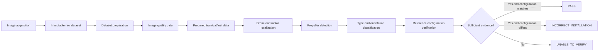

# Pluto Drone Inspection System Architecture

## Purpose

This project is being built to inspect the propeller assembly of a stationary
Pluto 1.2 drone from mobile-phone photographs. The system must identify the
four motor positions, determine whether propellers are present, classify the
propeller configuration, and report uncertain cases for manual inspection.

The system is intentionally evidence-first: an image that does not provide
enough evidence must result in `UNABLE_TO_VERIFY`, not a confident `PASS`.

## End-to-end architecture

The first five stages are implemented by the dataset pipeline. The computer
vision inference stages are planned next and must consume the prepared data
and verified annotations.

## Current implementation boundary

| Stage | Status | Implementation |
|---|---|---|
| Raw image discovery | Implemented | `src.prepare_dataset.discover_images` |
| Image decoding validation | Implemented | OpenCV decode check |
| Exact duplicate detection | Implemented | SHA-256 file hashes |
| Image quality measurement | Implemented | `src.quality_gate` |
| Aspect-preserving resize | Implemented | Maximum side configuration |
| YOLO label validation | Implemented | Optional `dataset/labels` input |
| Deterministic data splitting | Implemented | Seeded path hash |
| CSV/JSON manifests | Implemented | `dataset/manifests` |
| Drone localization | Planned | Requires annotations/model |
| Propeller detection | Planned | Requires annotations/model |
| Propeller type/orientation classification | Planned | Requires verified classes |
| Reference configuration verification | Blocked | `reference_config.json` is unconfirmed |

## Result-state rules

- `PASS`: all required components are detected with sufficient confidence and
  agree with a verified reference configuration.
- `INCORRECT_INSTALLATION`: the evidence is sufficient and a verified
  configuration mismatch is detected.
- `UNABLE_TO_VERIFY`: image quality, visibility, localization, classification,
  or reference information is insufficient.

A missing model detection is not automatically proof that a propeller is
missing. The system must distinguish “not detected” from “detected absence”.

## Safety boundary

The quality gate only assesses whether a photograph is technically suitable
for further inspection. It does not prove that the drone is assembled
correctly, that a propeller is mechanically secure, or that a motor rotates in
the expected direction.

The reference configuration is deliberately disabled until the official Pluto
1.2 arrangement is verified against authoritative documentation and the
physical hardware. See `src/config/reference_config.json`.
