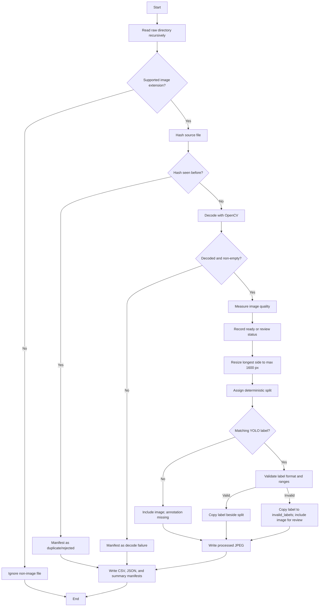

# Dataset Cleaning and Preprocessing Pipeline

## Goal

`src.prepare_dataset` converts the original photographs into a reproducible
dataset for annotation and later computer-vision training. It keeps the raw
files as the source of truth and records every decision in a manifest.

The repository calls the folder `dataset/`; the command also supports a
`datasets/` folder when that is the folder present in another checkout.

## Pipeline flowchart



## Step-by-step logic

### 1. Discover source files

The pipeline scans `raw_dir` recursively and accepts these extensions:

`.jpg`, `.jpeg`, `.png`, `.bmp`, `.tif`, `.tiff`, and `.webp`.

Files are sorted by their relative path. This makes processing order stable
across runs and supports nested source folders such as
`dataset/raw/drone_dataset/`.

Non-image files are ignored rather than treated as corrupt images.

### 2. Create a source fingerprint

Each source file is hashed with SHA-256 in 1 MiB chunks. Hashing the bytes,
rather than comparing filenames, identifies exact copies even when filenames
are different.

- First occurrence: continues through the pipeline.
- Repeated hash: is written to the manifest as a duplicate and is not copied
  to the prepared image splits.
- Raw duplicate: remains untouched in `dataset/raw`.

Only exact duplicates are detected. Visually similar photographs are not
removed because they may show different views or assembly details.

### 3. Decode the image

OpenCV loads each new source using `cv2.IMREAD_COLOR`. A `None` result or an
empty array means the file cannot be used by the pipeline. Such a record is
kept in the manifest with `processing_status=rejected` and an error message.

This catches invalid files before they reach preprocessing or model training.

### 4. Measure quality

`src.quality_gate.check_image_quality` calculates:

| Metric | Logic | Current threshold |
|---|---|---|
| Width/height | Minimum image dimensions | 640 × 480 |
| Laplacian variance | Edge/detail proxy for blur | At least 50 |
| Mean brightness | Average grayscale intensity | 40 to 220 |
| Dark-pixel fraction | Fraction of pixels below 10 | At most 0.35 |
| Bright-pixel fraction | Fraction of pixels above 245 | At most 0.35 |

The gate returns `READY` when no threshold is violated and
`UNABLE_TO_VERIFY` with reasons otherwise. The preparation pipeline maps those
states to `ready` and `review` respectively.

Quality warnings do not delete or silently discard decoded images. This is
intentional because the thresholds are provisional and a warning may still be
useful for annotation, calibration, or later review. The manifest preserves
the measured values and all warning reasons.

### 5. Resize without cropping

Images whose longest side is greater than `max_side` are scaled down using
`cv2.INTER_AREA`. The default maximum side is 1600 pixels.

The scale is:

```text
scale = max_side / max(original_width, original_height)
```

Both dimensions are multiplied by that same scale, so aspect ratio is
preserved and no propeller content is cropped. Images already below the limit
are left at their original dimensions. Processed files are written as JPEGs
with quality 95 by default.

No unrequested rotation, color correction, sharpening, denoising, or
augmentation is applied. These transformations can affect propeller shape or
orientation and should be introduced only after the dataset has been reviewed.

### 6. Generate a stable record ID

The source relative path, without its extension, becomes the record ID after
characters unsafe for filenames are replaced with underscores. If two paths
would produce the same ID, an 8-character hash suffix is added.

This gives every source a stable link between the raw file, processed image,
label, and manifest row.

### 7. Assign a deterministic split

The pipeline hashes `seed + relative source path` and converts the first part
of the hash into a value between 0 and 1:

- `[0.0, 0.8)`: `train`
- `[0.8, 0.9)`: `val`
- `[0.9, 1.0)`: `test`

The default seed is 42 and the default ratios are 80/10/10. No process-global
random state is used. Running the command again with the same seed, paths, and
ratios produces the same split assignment.

The split is assigned from the source path before output is written. This
means generated filenames and output directory ordering cannot change the
split.

### 8. Validate optional labels

The pipeline looks for a `.txt` file matching the source image stem under the
labels directory. A YOLO detection row must contain:

```text
class_id center_x center_y width height
```

Validation requires a non-negative integer class ID, four numeric values in
the normalized `[0, 1]` range, and non-zero width and height.

- No matching file: `annotation_status=missing`.
- Valid file: copied to the corresponding split's `labels/` directory.
- Invalid file: image remains available for review, but the label is copied to
  `invalid_labels/` and marked `annotation_status=invalid`.

The pipeline does not invent labels and does not modify supplied label text.

### 9. Write manifests

The output consists of:

```text
dataset/
├── processed/
│   ├── train/images/
│   ├── train/labels/
│   ├── val/images/
│   ├── val/labels/
│   ├── test/images/
│   ├── test/labels/
│   └── invalid_labels/
└── manifests/
    ├── dataset_manifest.csv
    ├── dataset_manifest.json
    └── dataset_summary.json
```

Every discovered supported source has a manifest row, including duplicates and
decode failures. Important fields include:

- source and output paths;
- source and output SHA-256 hashes;
- processing, quality, and annotation statuses;
- quality reasons and numerical metrics;
- original and processed dimensions;
- split assignment; and
- error or review information.

`dataset_summary.json` provides counts by status and split for quick checks.

## Command reference

From the repository root:

```bash
./.venv/bin/python -m src.prepare_dataset --clean
```

Useful options:

```bash
./.venv/bin/python -m src.prepare_dataset \
  --raw-dir dataset/raw \
  --output-dir dataset/processed \
  --manifest-dir dataset/manifests \
  --labels-dir dataset/labels \
  --max-side 1600 \
  --seed 42 \
  --train-ratio 0.8 --val-ratio 0.1 --test-ratio 0.1 \
  --clean
```

`--clean` removes the generated output and manifest directories before a new
run. It does not touch `dataset/raw`, `dataset/annotated`, or the source label
directory. The pipeline writes ownership marker files and refuses to remove an
existing output or manifest directory that does not contain its marker.

## Current dataset result

The initial run over this repository's source data found 81 readable JPEGs,
included all 81, and found no exact duplicates or labels. The split was 62
training images, 8 validation images, and 11 test images. The quality gate
classified 19 as `ready` and 62 as `review`; the review status is retained in
the manifest rather than used to delete images.
